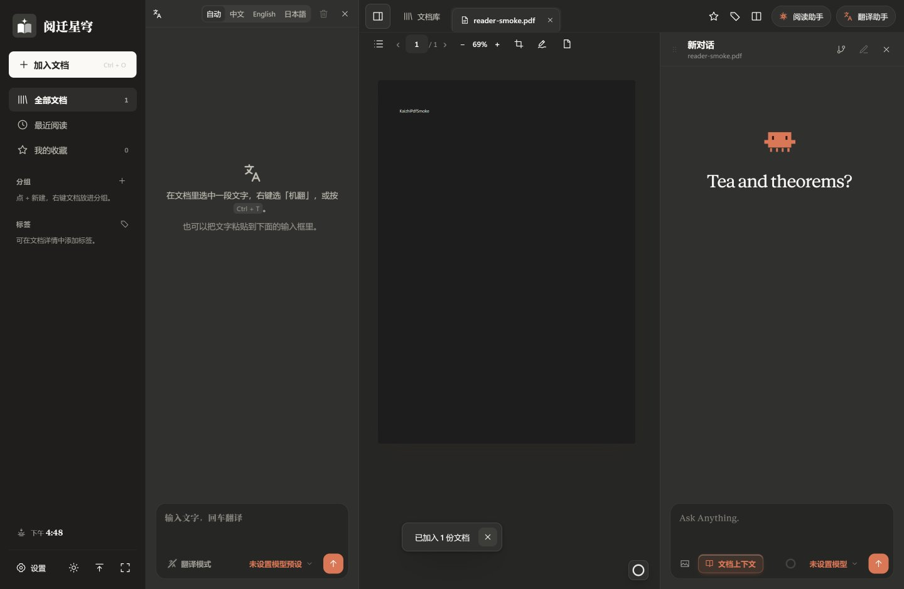
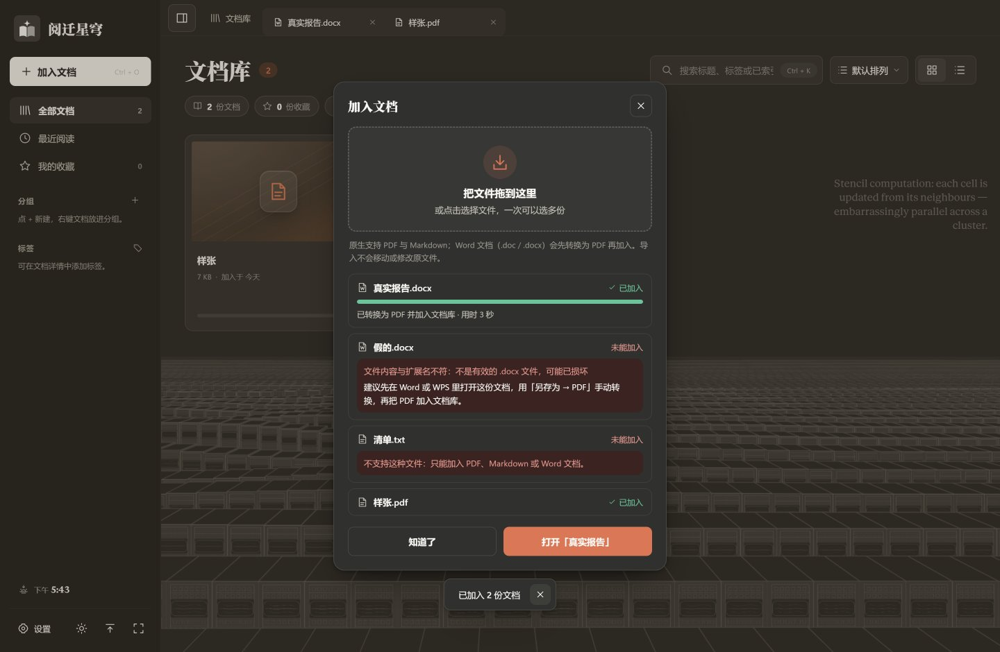
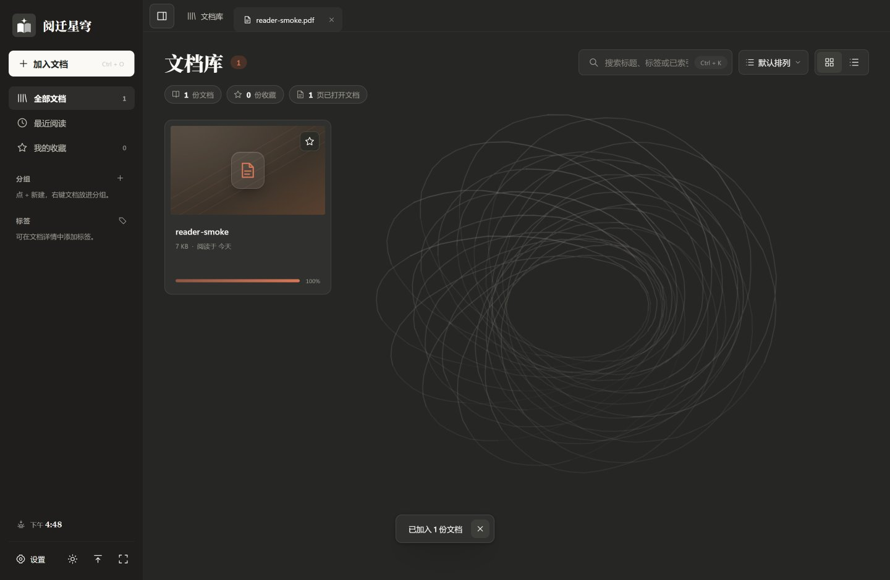

# 阅迁星穹
# 乱崎凶华--AI For Studying
阅迁星穹是一款 Windows 桌面 AI 阅读器：把 PDF、Markdown 和 Word 文档放进本地文档库，边读边问「阅读助手」、随手交给「翻译助手」翻译。界面是 Vue 3，外壳是 PySide6 / Qt WebEngine，文件、书库和凭据由本机 Python 服务管理，模型请求经本机 DeepSeek Harness 发给用户自己配置的 API。



**下载**：到 [Releases](https://github.com/luanqi-xionghua/AI-For-Studying/releases/latest) 下载 `YueqianXingqiong-<版本>-setup.exe`（安装版，推荐）或 `-portable.zip`（免安装版，完整解压后打开；旧版 Release 为单文件 EXE）。支持 Windows 10 / 11 x64，不需要另装 Python、Node 或其他运行环境。使用方法见 [使用手册](USAGE.md)。

## 核心能力

- **本地文档库**：PDF、Markdown 直接阅读；Word（.doc / .docx）加入时先用本机 Word、WPS 或 LibreOffice 转成 PDF。只记录原文件路径，不复制、不修改原文件。支持收藏、分组、标签、全文搜索、排序与框选批量操作。加入时可开启学习模式：两道自评、学习目标（必填）与可选的偏好说明/补充，作为这批文档的初始学习记忆。
- **阅读**：连续滚动的 PDF 渲染、文档内搜索、目录、书签、钢笔 / 荧光笔 / 下划线标记，最多三份文档并排阅读。
- **阅读助手**：打开文档时默认开启，按需检索当前文档、引用页内证据回答；可框选图表公式提问，可同时开多个助手窗口。
- **对话模式**：不打开文档直接和模型聊；可选「不使用记忆 / 全局记忆 / 某本书」，回答会带上学习记忆。模型与思考强度单独保存，不影响阅读助手。
- **学习记忆与记忆管理**：导入自评、阅读提问、对话与阅读进度会在后台整理成每本书的文档记忆和跨文档的总体画像；「记忆管理」页可以查看、编辑、删除单条、清空或手动重新总结，也可以关掉自动更新。这些记忆会用于对话模式、阅读助手（含文档工具调用）、翻译助手、快速解释和「猜你想问」；所有记忆只保存在本机文档库。
- **翻译助手与快速解释**：选中文字右键「机翻」或按 Ctrl+T；翻译模式下选中即译；选中后按鼠标中键快速解释。两者都会带上当前文档的学习记忆，让术语与讲法更贴合你的水平。
- **用户自带 API**：Chat Completions、Responses、Anthropic Messages 三种协议，密钥按服务商与完整端点隔离，可用 Windows DPAPI 加密保存。
- **四种外观**：液态玻璃、新液态玻璃、暖色极简（新装默认）、铅笔草稿，浅色 / 深色跟随系统。

## 界面预览

### 加入文档与 Word 转换

拖入或选择文件；Word 显示转换进度，失败时写明原因并建议先手动另存为 PDF。



### 暖色极简文档库



## 技术架构

| 层 | 技术 | 作用 |
| --- | --- | --- |
| 界面 | Vue 3 / TypeScript / Vite，PDF.js，KaTeX，Mermaid | 文档库、阅读器、助手面板、设置 |
| 桌面外壳 | PySide6 / Qt WebEngine | 窗口、拖放、原生文件对话框、全屏 |
| 本机服务 | Python / aiohttp，SQLite | 只监听 IPv4 回环地址；令牌鉴权的 HTTP 命令与 WebSocket 事件 |
| 模型运行时 | DeepSeek Harness（Node.js 子进程） | 统一调用用户选择的模型 API，流式输出、工具回传、取消 |
| 文档转换 | 本机 Word / WPS / LibreOffice | Word 转 PDF，结果缓存在数据目录 |

所有模型请求只走一条路：**阅读器界面 → 已认证的本机 Python 服务 → Harness 子进程 → 用户选择的 API 地址**。没有前端直连、通用 HTTP 代理或本机 Codex 登录。

## 项目结构

```text
阅迁星穹/
  README.md / USAGE.md      项目说明 / 使用手册
  Start.cmd                 源码环境一键启动
  backend/                  Python 本机服务
    main.py                 入口（源码运行与打包后的 EXE 共用）：--smoke、--harness-smoke、--office 等参数
    requirements.txt        Python 依赖
    api/                    HTTP / WebSocket 接口、鉴权与命令分派（server.py）
    core/                   桌面外壳：Qt 窗口与原生对话框（desktop.py），Windows 凭据与子进程作业（windows.py）
    runtime/                模型运行时：Harness 子进程管理、请求与取消（harness.py）
    services/               业务服务：文档库 SQLite（library.py）、Word 转 PDF（word.py）、版本更新（updates.py）
    scripts/                自检脚本：PDF 导入渲染（pdf_smoke.py）、模型运行时（harness_smoke.py）
    tests/                  后端测试
  frontend/                 Vue 3 前端
    src/components/         按业务分组的界面组件
      assistant/            阅读助手、模型选择、用量、快速解释卡片
      translate/            翻译助手、选中即译浮窗
      chat/                 对话模式页、记忆范围、历史、消息与输入栏
      memory/               记忆管理页、设置区、文档 / 全局记忆面板
      reader/               PDF / Markdown 阅读器、文档内搜索、书签、并排选择、标记工具（ink/）
      library/              加入文档窗口
      settings/             设置、AI 预设、更新
      layout/               文件标签、右键菜单、计时器、背景流形
      markdown/             Markdown 渲染扩展（中文强调、GitHub 语法、公式）
      ui/                   图标等基础组件
    src/ai/                 模型预设、统一调用、翻译、解释、阅读助手工作区
    src/chat/               对话模式的会话状态、模型选择、历史裁剪与存储
    src/memory/             记忆类型、归一化、事件、提示词、合并、调度、存储与引擎
    src/reader/ src/document/  PDF 渲染核心、选区、标记数据、文档会话
    src/library/            文档种类、书签、封面、分组、加入文档队列
    src/sdk/                界面与本机 Python 服务之间的命令和事件通道
    src/settings/ src/shared/ src/ui/ src/styles/  偏好设置、共享协议、界面工具、样式
    tests/unit/、tests/sim/  前端单测、Vue 组件模拟测试
  harness/                  Node 模型运行时（独立 npm 工程，和 frontend 并列）
  scripts/                  Windows 打包（build-windows.ps1）、安装包（installer.nsi）、图标与版本信息生成
  docs/                     开发交接（HANDOFF.md）与 README 截图（images/）
```

## 本地启动

### 方式一：安装版 / 免安装版（推荐使用）

从 [Releases](https://github.com/luanqi-xionghua/AI-For-Studying/releases/latest) 下载：

- **安装版** `YueqianXingqiong-<版本>-setup.exe`：只为当前用户安装（不需要管理员权限），装到 `%LOCALAPPDATA%\Programs\YueqianXingqiong`，在开始菜单和「设置 → 应用」里显示为「阅迁星穹」，可选桌面快捷方式，支持应用内自动更新。
- **免安装版** `YueqianXingqiong-<版本>-portable.zip`：完整解压后运行文件夹中的 `YueqianXingqiong.exe`，不要从压缩包内启动或只移动 EXE。更新会就地刷新这个文件夹，不写卸载项或快捷方式。旧版单文件用户请从发布页手动迁移一次；书库和设置不用搬。

两种版本共用同一个数据目录。下载后可用同一页面的 `SHA256SUMS.txt` 核对文件。安装包和程序没有代码签名证书，首次运行时 Windows SmartScreen 可能提示「已保护你的电脑」，确认来源后点「更多信息 → 仍要运行」。

### 方式二：源码运行（推荐开发）

需要 Windows、Python 3.13 x64、Node.js（本项目用 Node 26 x64）和 npm。在项目根目录执行：

```powershell
py -3.13 -m venv .venv
.\.venv\Scripts\python.exe -m pip install -r backend\requirements.txt
npm.cmd --prefix harness ci
npm.cmd --prefix frontend ci
npm.cmd --prefix frontend run build
.\.venv\Scripts\python.exe backend\main.py
```

配置好后也可以双击 `Start.cmd`。改了前端请重新构建并重启窗口；只改 Python 则重启即可。直接打开前端网址不会启动阅读器。

### 打包

```powershell
.\.venv\Scripts\python.exe -m pip install 'PyInstaller>=6.18,<7'
winget install NSIS.NSIS --source winget          # 只有生成安装包时需要
powershell.exe -NoProfile -File scripts\build-windows.ps1 -Test -Release
```

先关闭正在运行的阅迁星穹，否则无法覆盖 `dist` 里的文件。`-Test` 会先跑前后端测试，打包后再实际启动 EXE 检查 Harness 和 PDF；`-Installer` 另用 NSIS 生成安装包；`-Release` 含 `-Installer`，并在 `dist\release\` 放好发布用的安装包、便携版和 `SHA256SUMS.txt`。PowerShell 执行策略受限时加 `-ExecutionPolicy Bypass`。图标由 `scripts/make-icon.py` 从 `frontend/public/favicon.svg` 生成，EXE 的版本信息由 `scripts/make-version-info.py` 按 `backend/__init__.py` 的 `VERSION` 生成。安装版和便携版共用 PyInstaller 目录构建：Qt、前端、Harness 和 Node 位于 EXE 旁的专用运行库目录，启动时不再解包；默认用 Node 26.13.0 打包，更换 Node 时用 `KAIZHI_NODE_LICENSE` 指向对应版本的 LICENSE。

## 环境变量

| 变量 | 作用 |
| --- | --- |
| `KAIZHI_DATA_DIR` | 改用别的数据目录（同 `--data-dir`）。默认 `%APPDATA%\com.phydog.reading.python` |
| `KAIZHI_RELEASE_REPO` | 检查更新用的 GitHub 仓库，默认 `luanqi-xionghua/AI-For-Studying` |
| `KAIZHI_NODE_LICENSE` | 打包时随 EXE 附带的 Node 许可文件 |
| `KAIZHI_TEST_OFFICE=1` | 测试时用本机 Word / WPS / LibreOffice 做一次真实转换 |

## 开发与测试

先构建前端，再在项目根目录执行：

```powershell
npm.cmd --prefix frontend test                                        # 前端单测
npm.cmd --prefix frontend run build                                   # 类型检查与构建
.\.venv\Scripts\python.exe -m unittest discover -s backend/tests -t . -v   # 后端测试
.\.venv\Scripts\python.exe backend\main.py --smoke                    # 临时书库导入合成 PDF，检查渲染与本地接口
.\.venv\Scripts\python.exe backend\main.py --harness-smoke            # 本机模拟 API 检查模型运行时，不用真实密钥
# 打包后：等待 GUI 程序退出，ExitCode 应为 0
(Start-Process .\dist\YueqianXingqiong\YueqianXingqiong.exe -ArgumentList '--smoke' -WindowStyle Hidden -Wait -PassThru).ExitCode
```

关键入口：

| 功能 | 位置 |
| --- | --- |
| 启动、窗口、选择文件、拖放与全屏 | `backend/main.py`、`backend/core/desktop.py` |
| 桌面命令、二进制响应、流式事件与鉴权 | `backend/api/server.py`、`frontend/src/sdk/python.ts` |
| SQLite、全文检索、备份恢复、重定位、导入校验 | `backend/services/library.py` |
| Word 转换与失败原因、Windows 凭据 | `backend/services/word.py`、`backend/core/windows.py` |
| 加入文档窗口与导入队列 | `frontend/src/components/library/ImportDialog.vue`、`frontend/src/library/importer.ts` |
| AI 运行时、取消、文档工具回传 | `backend/runtime/harness.py`、`harness/runtime.mjs`、`frontend/src/ai/harness.mjs` |
| 单次任务（翻译、解释、出题）入口 | `frontend/src/ai/complete.ts` |
| PDF 连续渲染/选区/索引、AI 文档工具与请求队列 | `frontend/src/reader/core/`、`frontend/src/shared/` |
| 更新筛选、SHA-256 验证与安装 | `backend/services/updates.py` |

学习相关的功能已经接入：对话模式、学习记忆与记忆管理；阅读助手（含文档工具调用）、翻译助手、快速解释和「猜你想问」都会读取学习记忆。练习出题、错题与复习安排仍在规划中。生成练习题或解释错题可以复用 `frontend/src/ai/complete.ts` 的单次任务入口；需要引用当前 PDF 的问答可复用 `streamDocumentChat`。学习记忆与对话模式记录属于应用数据，保存在本机文档库，不放在 Harness 会话里。

## 数据、隐私与安全说明

- 默认数据目录是 `%APPDATA%\com.phydog.reading.python`。不要把 `--data-dir` 或 `KAIZHI_DATA_DIR` 指向已有书库所在的目录，也不要让两个实例同时写同一个数据库。
- 设置 → 文档库可以导出 SQLite 备份；恢复会**替换当前书库**（进度、书签、分组、AI 对话、学习记忆和对话模式记录），不含原文件和单独加密的 API 密钥。文件移动后可在书卡重新定位，保留原 ID 和阅读记录。
- 需要试读另一份书库时，先退出程序并备份，把 `library.sqlite3` 与存在的 `-wal` / `-shm` 一并复制到**新的空目录**，再运行 `backend\main.py --data-dir "副本的绝对路径"`。凭据需单独复制 `credentials`，DPAPI 数据只能由原 Windows 用户读取。界面偏好不会随书库一起迁移。
- **API 密钥**：请在设置里为使用的 API 地址输入一次；密钥按服务商和完整端点隔离，可只放内存，勾选「记住」才写入 Windows DPAPI；界面不能读回明文，也不会回退到其他账号或服务商。远程 API 须 HTTPS，本机兼容服务可用回环 HTTP。
- **发给模型的内容**：选区、阅读器检索出的证据和按需截图会发给用户所选的服务商。Harness 只装载模型服务和多服务商适配器，不加载 Shell、磁盘工具、用户的 Harness 配置或会话日志插件。
- **学习记忆与对话模式记录**：保存在本机文档库的 `settings` 表里，随备份导出与恢复；模型预设（包括「记忆管理」用的预设与思考强度）保存在本机，不随备份迁移。只有在你实际用到记忆的功能里，相应的记忆片段才会随请求发给你配置的模型服务商：记忆总结、对话模式、阅读助手（含文档工具调用）、翻译、快速解释和猜你想问；不会发送整本书的内容。「不使用记忆」的对话既不读取也不写入记忆。
- 本地服务只监听 IPv4 回环地址；特权请求校验 Host、来源和每次启动生成的令牌，WebSocket 也须认证。不要把接口暴露到局域网或公网。

## 更新与发布

版本号只在 `backend/__init__.py` 的 `VERSION` 里改一处，EXE 版本信息、安装包和更新器都从这里读。发布新版本：

1. 改 `VERSION`，运行 `scripts\build-windows.ps1 -Test -Release`。
2. 在 GitHub 新建 Release，标签 `vX.Y.Z`，上传 `dist\release\` 里的三个文件，例如：
   `gh release create vX.Y.Z dist\release\* --repo luanqi-xionghua/AI-For-Studying --title "阅迁星穹 X.Y.Z" --notes-file <说明文件>`

应用内更新器只认 `vX.Y.Z`（也接受旧的 `python-vX.Y.Z`）标签下、GitHub 记录了 SHA-256 摘要的 `YueqianXingqiong-X.Y.Z-setup.exe`，下载后校验摘要再静默更新并自动重新打开。便携版还会确认该 Release 提供同版本 `-portable.zip`，使用同一已校验更新包的便携模式，仅更新自己的目录。数据目录 `com.phydog.reading.python` 和 `KAIZHI_*` 变量保持既有命名，已保存的书库与设置继续可用。源码模式只提示新版本。推送源码不会自动生成 Release。

变更记录、验收边界和后续事项见 [开发交接](docs/HANDOFF.md)，使用方法见 [使用手册](USAGE.md)。

## License

项目代码使用 [MIT 许可](LICENSE)；第三方组件见 [THIRD_PARTY_NOTICES.md](THIRD_PARTY_NOTICES.md)。
